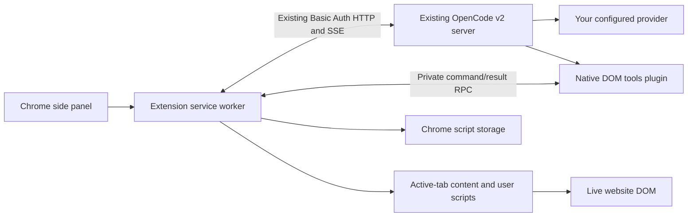

# Open Extension

A Manifest V3 Chrome/Brave side panel for your **existing local OpenCode server**. Ask about the active page, make a live DOM change, verify it, then approve a reversible script for that website. All AI requests, reasoning, tool execution records and chat history belong to your OpenCode backend.

[Download the latest release](https://github.com/cryptobredda/open-extension/releases/latest) · [Report an issue](https://github.com/cryptobredda/open-extension/issues)

## Install

Requires **Chrome/Brave 138+** and **OpenCode 2.0.29** with a configured agent and tool-capable model. Newer compatible v2 versions should work; the native plugin protocol is checked when connecting. There is **no separate bridge process, port, token or Node installation** for a prebuilt install.

1. Download **`open-extension-chrome-v1.3.1.zip`** from Releases and extract it.
2. Open `chrome://extensions`, enable Developer mode, choose **Load unpacked**, and select the extracted `open-extension/extension` directory.
3. On the extension’s **Details** page, enable **Allow User Scripts**. Click the extension icon or press **Alt+Shift+O** to open the panel.
4. Open **Connection settings**. Run `opencode pair` and paste a **fresh, unopened full pairing link** into the extension. Alternatively, enter the local service origin and service password, with username `opencode` unless customized. Click **Pair & connect** or **Save & connect**.
5. Click **Enable native browser tools**. This installs the bundled `.opencode/plugins/open-extension.js` into OpenCode’s current project and reloads its plugins. Wait for **Ready in OpenCode**. Installation waits until all backend turns have finished. The agent does not perform this installation and is not granted file access.
6. Open a regular website, choose a connected model in the composer, and describe a change.

Default service ports are **49374** on macOS/Linux/WSL and **45278** on Windows. **Discover** checks common local ports; manually configured private LAN or `.local` origins work through your system resolver. The extension does not implement an mDNS browser. Pairing links are single-use and expire; entering the service’s actual password also works. Credentials stay in the extension service worker and are never injected into websites. Remembering the password uses Chrome local storage, which is not an encrypted vault; otherwise it lasts only for the browser session.

The project directory setting selects the OpenCode location and plugin installation directory. Enable the native plugin once for each project you use. Your existing backend sessions remain accessible from the conversation history button. An attached conversation uses browser-only permissions **for that session**, including when opened by another OpenCode client. Start a separate session for ordinary filesystem work.

To build from source, install Node.js 22+, then:

```sh
git clone https://github.com/cryptobredda/open-extension.git
cd open-extension
npm ci
npm run build
```

Load `dist` as the unpacked extension and follow steps 3–6. The complete project ZIP includes sources and a compiled `dist` directory. The bundled plugin is self-contained; it does not need npm dependencies installed beside it. You can also install `dist/open-extension-plugin.js` manually at `.opencode/plugins/open-extension.js` in the selected OpenCode project and reload that location.

## Upgrading from 1.3.0

Replace the compiled files in the **same unpacked extension folder** and click Reload on the existing Chrome extension entry. Open **Connection** and enable/update the native browser tools so the backend receives the new execution guard. No new bridge or pairing key is needed. Reconnect to the local server only if the extension no longer has its session credential.

## Upgrading from the bridge releases

Replace the compiled files in your **existing unpacked extension folder**, then click **Reload** on the existing entry in `chrome://extensions`. If building from the same checkout, use `git pull`, `npm ci` and `npm run build` before Reload. Keep the same folder and extension entry: loading a different folder can create a new extension ID with separate Chrome storage. Reconnect to OpenCode and click **Enable native browser tools**. Saved scripts, connection preferences and model selection are retained when the extension ID stays the same. Old bridge credentials are discarded. Stop the old `npm run bridge` process; it is no longer used. A legacy runtime MCP registration is not needed and cannot be used by browser-only sessions because native DOM tools use their own permission names.

OpenCode 1.x server identities can still be recognized for a useful upgrade message, but browser editing now requires the native v2 plugin API. Existing approved site scripts work independently of the backend connection.

## Why the bridge was removed

Earlier releases used a loopback MCP server so the backend could dispatch tool calls into Chrome. Chat and model traffic already went straight to the existing OpenCode backend; the bridge never proxied inference. OpenCode 2.0.29 supports native server plugins and authenticated RPC/event endpoints, so the extra listener and pairing credential are unnecessary.



The plugin exposes seven DOM tools through OpenCode’s **native Execute / Code Mode** interface. A durable execution guard enforces browser-only sessions; see the free-tier compatibility explanation below for the two permission-gated native interfaces. It has no model client, socket listener or chat store. Commands carry a per-turn capability and are bound to a session attachment. Only command IDs appear on SSE; arguments are fetched through authenticated RPC. Attachments expire without a heartbeat. The extension rechecks the foreground tab, exact URL and document before acting, and revokes access on tab/navigation changes, panel closure, interruption or turn completion.

The built-in OpenCode desktop browser plugin also has a native RPC interface, but its shared browser permission includes file transfers, other tabs and desktop-specific operations. This extension registers a smaller DOM-only namespace so it can deny local files, shell commands, other MCP servers and unrelated browser operations without changing your global agent configuration. All page JavaScript runs through Chrome; OpenCode’s sandboxed Execute runtime orchestrates those browser calls.

Implementation references: [OpenCode v2 API](https://opencode.ai/v2/docs/api), [building a client](https://opencode.ai/v2/docs/build/client), [v2.0.29 plugin RPC types](https://github.com/anomalyco/opencode/blob/v2.0.29/packages/plugin/src/promise/rpc.ts), [native browser connection](https://github.com/anomalyco/opencode/blob/v2.0.29/packages/plugin-browser/src/connection.ts), [Code Mode permission filtering](https://github.com/anomalyco/opencode/blob/v2.0.29/packages/core/src/tool.ts). The extension uses the official `@opencode/client` and the server’s `/api/*` API, `/api/event` stream and `/openapi.json` spec. `/doc` and `/global/health` belong to the legacy API.

## Models and the OpenCode free-tier error

The searchable model picker in the composer lists enabled models from your **existing backend’s connected providers**. Selecting a model updates the actual backend session; model changes made by another OpenCode client appear in the picker. Provider credentials remain on the backend. Open Extension does not impersonate a different client or send requests directly to model providers.

OpenCode has a [known free-tier bug with restricted tool catalogs](https://github.com/anomalyco/opencode/issues/51241), also tracked in [#50627](https://github.com/anomalyco/opencode/issues/50627). Removing the native file-reading or shell interfaces can make a genuine OpenCode session fail with:

> OpenCode’s free tier can only be used from within OpenCode. Download it at https://opencode.ai and keep building.

**Version 1.3.1 adds a compatibility fix.** It retains the real native `read` and `shell` interfaces in OpenCode’s permission-gated `ask` state, following the upstream workaround, while a separate native server guard rejects their execution before their implementations run. It does not grant file or shell access. Only Execute and the seven DOM operations may run in a protected browser session. The guard persists across panel closure, plugin reloads and backend restarts, and it also blocks attempts made from another OpenCode client or after a session permission change. Other OpenCode sessions remain unaffected. No client identity, headers or provider credentials are impersonated or rewritten.

Verified with **OpenCode 2.0.29 and DeepSeek V4.1 Flash Free**: the real free model removed a live test-page section, re-observed the DOM, proposed a script update, and its approved script persisted after refresh. Regression tests also verified that real local file and shell attempts were blocked.

Update **both the extension and its native plugin**: replace the build in the same unpacked extension folder, click Reload, then open **Connection → Enable native browser tools** (or **Update native browser tools**). The new protocol checks for the execution guard and refuses to configure compatibility permissions with an older plugin. You can then retry in the same conversation; existing failed messages remain in history.

The 1.3.0 diagnosis was incomplete: the bridge was unrelated, but the failure is an upstream bug affecting restricted clients, rather than an unavoidable ban on this extension. A provider outage, model retirement or quota restriction can still produce separate errors; the compatibility fix does not remove those limits.

## Website workflow and script library

- **Observe:** every request supplies a fresh snapshot of the active URL, title, relevant DOM, attributes, text and sanitized HTML. The agent can query the live page for more detail. “Remove Relevant people” refers to the website, not files on your machine.
- **Experiment and verify:** JavaScript, CSS, DOM operations, event listeners and MutationObservers apply immediately. Each mutation returns a fresh observation, and the agent is instructed to check actual DOM/computed state before claiming success. A completed model turn is not proof of a page change.
- **Approve:** the **Install site script?** / **Update site script?** card shows the name, domains, description and complete source. **Install** or **Update script** saves it; **Deny** keeps it temporary. Only this user action persists generated code.
- **Apply to the website:** proposed matchers default to every route of the exact current hostname, e.g. `*://x.com/*`. Other domains cannot be silently added. Saved scripts run on page loads, refreshes and SPA navigation, even with OpenCode and the panel closed. `api.watch` handles late or changing DOM without navigation.
- **Manage:** the top **Scripts** tab has **This site / All sites**, keyword/domain search, **Website / Name / Recently updated** sorting, and enabled/disabled filtering. This site includes scripts for other routes on that hostname; explicit wildcard matchers include their authorized subdomains. Sort/status preferences persist. Each script has a toggle, source editor, agent update action and delete action.
- **Teach another layout:** disable the script, open the page with the different layout, choose **Scripts → Update with agent**, and describe the additional section. The agent receives the existing code and proposes a complete replacement that preserves earlier layouts. Approval updates and enables the same script instead of making a duplicate.
- **Undo:** a toggle or delete unregisters future injection and immediately cleans up tracked changes in matching open tabs. The top undo button clears temporary experiments without disabling saved scripts.

Live tools authorize only the active tab at the time you send a message; they never accept an agent-selected tab ID. Switching tabs or URLs ends that authorization. Send a new message to authorize the new page. Approved saved scripts apply in all tabs matching their approved domains.

## Reversible script API

Script code is the body of an async function with `api` and DOM globals available. Saved scripts default to the isolated `USER_SCRIPT` world; select `MAIN` only when access to the page's JavaScript globals is needed. Live experiments execute in `MAIN`. Credentials and extension APIs are never injected into either world.

```js
api.css(`
  .promo, .newsletter-popup { display: none !important; }
  main { max-width: 76ch; margin-inline: auto; }
`);

// Runs immediately and when content, attributes or text change. DOM writes inside the callback
// do not trigger the same observer again. Helpers keep per-script undo layers.
api.watch(() => {
  api.text('.page-title', 'My workspace');
});

const button = document.querySelector('.shortcut');
if (button) {
  api.on(button, 'click', () => {
    document.querySelector('main')?.scrollIntoView({ block: 'center' });
  });
}
```

| Helper                                                     | Behavior on disable/delete/reset                                              |
| ---------------------------------------------------------- | ----------------------------------------------------------------------------- |
| `api.css(css)`                                             | Removes its constructed stylesheet; also works under strict inline-style CSP. |
| `api.hide(selectorOrElement)`                              | Removes its hiding rule or restores the element's hidden attribute.           |
| `api.remove(selectorOrElement)`                            | Restores original nodes at retained placeholders.                             |
| `api.text(selectorOrElement, text)`                        | Restores original child nodes, including their event listeners.               |
| `api.attr(selectorOrElement, name, valueOrNull)`           | Restores the preceding attribute layer.                                       |
| `api.append(selectorOrElement, node)`                      | Removes the appended node.                                                    |
| `api.on(target, event, listener, options?)`                | Removes its listener.                                                         |
| `api.watch(callback, root?)`                               | Disconnects its MutationObserver. Defaults to the document element.           |
| `api.interval(callback, ms)` / `api.timeout(callback, ms)` | Clears its timer.                                                             |
| `api.onCleanup(callback)`                                  | Runs custom cleanup in reverse registration order.                            |
| `api.query(selector)` / `api.queryAll(selector)`           | Returns matching DOM elements.                                                |

Callbacks should be idempotent. A script may return a cleanup function, and partial helper effects are cleaned up if execution fails. Async setup has a 20-second deadline; event handlers and registered observers may live for the document lifetime. If you construct an observer or listener directly, disconnect/remove it in `api.onCleanup`.

**Reversibility has a concrete boundary:** helper-managed page effects are undone immediately. Arbitrary JavaScript that changes untracked application state may require a page reload. External effects such as sending a request, submitting a form, or clicking a purchase button cannot be undone by a script toggle. Persistent scripts generated by the agent are instructed to use the helpers and explicit cleanup.

## Development and verification

```sh
npm ci
npm run check            # TypeScript, unit checks, production build
npx playwright install chromium
npm run test:e2e         # Native RPC fixture + real Chrome, library/restart workflow
npm run package          # Chrome-only and complete-project ZIPs
```

For a real backend/provider/tool contract, point to an **OpenCode 2.0.29 binary**:

```sh
OPENCODE2_BINARY=/absolute/path/to/opencode npm run test:e2e
```

This starts an isolated backend with temporary config/data directories and a deterministic local OpenAI-compatible provider. It installs the native plugin through the actual extension UI, checks the native DOM catalog and permission-gated interfaces, and lets OpenCode execute all browser calls itself. It exercises removal, re-observation, approval, domain-wide reload/SPA persistence, an update for a second layout, cleanup, connected model selection and model changes from another client. Deliberate native file-reading and shell attempts are blocked, including after a plugin reload and permission approval from another client. It does not affect your shared service or send paid provider requests. The regular Chrome tests also check pairing, reasoning streams, strict page CSP, listener cleanup, active-tab revocation, script-library filtering/sorting/deleting and browser-restart persistence. Tests verify the workflow with controlled model outputs; they cannot establish correct selectors for every model on every website.

For an optional **live free-provider** DOM smoke test (subject to provider availability/quota), add:

```sh
OPENCODE2_BINARY=/absolute/path/to/opencode \
OPENCODE_FREE_MODEL=opencode/deepseek-v4.1-flash-free \
npx playwright test real-v2-dom.spec.ts
```

This uses the real free model to modify and observe a local test website through Chrome, then propose a persistent site script. Regular CI uses the deterministic local provider and does not consume free-provider quotas.

Source layout: `src/panel` (React interface), `src/background` (server proxy, session/attachment lifecycle, browser authorization and storage), `src/native` (in-process OpenCode plugin and RPC protocol), `src/content` (DOM observation and reversible runtime), `src/shared` (schemas and view models), `tests` (native protocol, lifecycle and browser contracts).

Licensed under MIT. Dependencies retain their own licenses; bundled files preserve their license notices.
